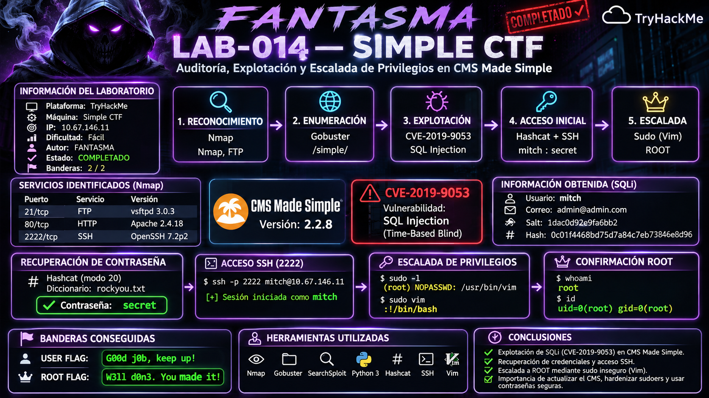

# 😈 FANTASMA | LAB-014 — SIMPLE CTF

**TryHackMe | FANTASMA LAB-014 SIMPLE CTF | Nmap, FTP, Gobuster, CMS Made Simple 2.2.8, SQL Injection CVE-2019-9053, SearchSploit, Python 3, Hashcat, SSH, Sudo Vim y escalada ROOT | 2 banderas conseguidas**

## Información del laboratorio

- Plataforma: TryHackMe
- Máquina: Simple CTF
- IP: 10.67.146.11
- Dificultad: Fácil
- Autor: FANTASMA
- Estado: COMPLETADO
- Resultado: acceso ROOT confirmado
- Banderas: 2 de 2

## 1. Objetivo

Realizar una auditoría de seguridad en un entorno controlado, identificar servicios expuestos, enumerar la aplicación web, explotar una vulnerabilidad SQL Injection, recuperar credenciales, obtener acceso SSH y escalar privilegios hasta ROOT.

## 2. Reconocimiento

Nmap identificó tres servicios:

| Puerto | Servicio | Versión |
|---|---|---|
| 21 | FTP | vsftpd 3.0.3 |
| 80 | HTTP | Apache 2.4.18 |
| 2222 | SSH | OpenSSH 7.2p2 |

Se confirmó acceso FTP anónimo, aunque el listado presentó problemas de conexión de datos.

## 3. Enumeración web

Gobuster descubrió:
- /robots.txt
- /simple/
- /index.html

La ruta /simple/ alojaba CMS Made Simple.

La versión identificada en el HTML fue CMS Made Simple 2.2.8.

## 4. Identificación y explotación

SearchSploit localizó el exploit 46635, relacionado con CVE-2019-9053.

La vulnerabilidad permite SQL Injection basada en tiempo (Time-Based Blind SQL Injection).

Se adaptó una copia del script de Python 2 a Python 3 mediante Fissix. Se corrigió también la lectura del diccionario para utilizar codificación Latin-1.

Información recuperada:
- Usuario: mitch
- Correo: admin@admin.com
- Salt: 1dac0d92e9fa6bb2
- Hash: 0c01f4468bd75d7a84c7eb73846e8d96

## 5. Recuperación de contraseña

Hashcat utilizó el modo 20 (MD5 con salt antepuesto) y el diccionario RockYou.

Resultado:
- Usuario: mitch
- Contraseña recuperada: secret

## 6. Acceso inicial SSH

Se identificó SSH en el puerto 2222.

Se obtuvo una sesión remota como mitch.

Sistema: Ubuntu 16.04.6 LTS, arquitectura i686.

## 7. Escalada de privilegios

La enumeración con sudo -l mostró:

(root) NOPASSWD: /usr/bin/vim

Se ejecutó Vim con privilegios administrativos y se utilizó su función de comandos externos para iniciar Bash.

Verificación:
- whoami: root
- id: uid=0(root) gid=0(root)

La escalada fue posible por una configuración insegura de sudoers.

## 8. Banderas recuperadas

**USER FLAG**
G00d j0b, keep up!

**ROOT FLAG**
W3ll d0n3. You made it!

## 9. Conclusiones y recomendaciones

1. Desactivar el acceso FTP anónimo cuando no sea necesario.
2. Actualizar CMS Made Simple a una versión corregida.
3. Utilizar consultas SQL parametrizadas.
4. Almacenar contraseñas mediante algoritmos modernos de derivación de claves.
5. Evitar contraseñas débiles y reutilizadas.
6. Aplicar el principio de mínimo privilegio en sudoers.
7. No permitir editores con capacidad de ejecutar comandos externos como ROOT sin controles.

## 10. Herramientas utilizadas

Nmap, Gobuster, FTP, Curl, SearchSploit, Exploit-DB 46635, Python 3, Fissix, Hashcat, RockYou, SSH y Vim.

---
**FANTASMA | LAB-014 | SIMPLE CTF | ROOT CONFIRMADO**
